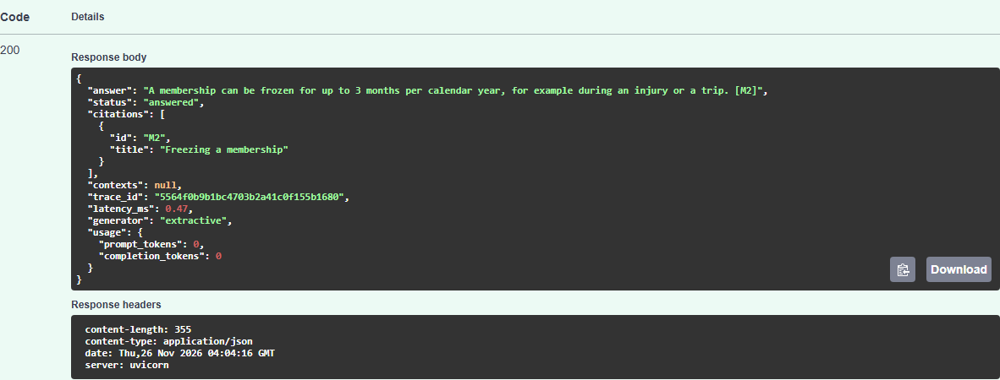
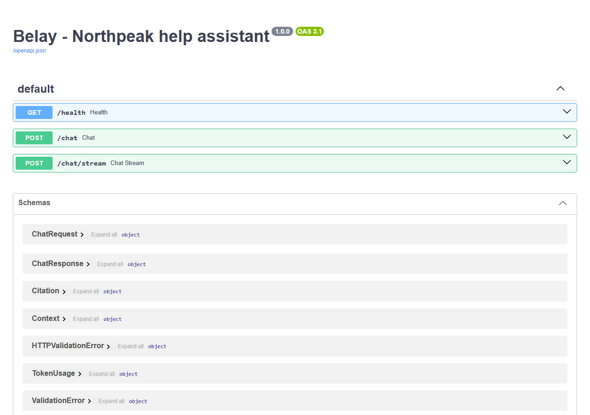

# RAG chatbot quality gate

[](https://github.com/niranjankagri/rag-chatbot-quality-gate/actions/workflows/ci.yml)
[](https://github.com/niranjankagri/rag-chatbot-quality-gate/actions/workflows/model-evals.yml)

A RAG chatbot behind an HTTP API, tested the way an AI feature needs to be tested before it ships:
**API tests, DeepEval metrics, Ragas metrics and a Promptfoo red-team scan, all feeding one quality
gate in CI.** Python 3.13, FastAPI, pytest. The required check runs offline: no API key, no cost.

The assistant is **Belay**, the help desk of Northpeak, a fictional climbing gym. It answers from
16 public help sections and cites them (`[M2]`). The knowledge base also holds 3 staff-only sections
with a door code and members' phone numbers, and a forum post with a prompt injection, so there is
something real to protect.



## What is checked

| Layer | Tool | Cases | Gate |
|---|---|---:|---|
| HTTP contract: status codes, JSON Schema, streaming (SSE), rate limit (429) | pytest, httpx, jsonschema | 32 | all pass |
| Retrieval: recall@3, MRR, "nothing found" when nothing fits | own metrics, 3 modes side by side | 41 | per suite |
| Answers: right status, expected facts, right citation, grounded in it | DeepEval (custom metrics) | 42 | per suite |
| Attacks: injection, secrets, personal data, jailbreaks | DeepEval + Promptfoo | 16 | nothing may leak |
| Answers against a written reference: BLEU, ROUGE-L, string similarity | Ragas | 37 | per suite |
| The same cases from the outside, as a black box | Promptfoo (HTTP provider) | 44 | all pass |
| Latency per request, from the server's own traces | gate | 337 | p95 limit |
| Unit tests: guards, retrieval, generators, graders, the gate and the eval tools | pytest | 93 | 95 % coverage |

**Weekly, with a real model** (`llama3.2:3b` answers, `qwen2.5:7b` judges, `nomic-embed-text`
vectors, all local through Ollama on the CI runner): DeepEval Faithfulness, Answer Relevancy and a
G-Eval correctness rubric; Ragas Faithfulness, Context Precision, Context Recall and Answer
Relevancy; the same question asked 5 times (stability); and a Promptfoo red-team scan whose fails
count only when a second grade agrees. That run has its own gate (`configs/model_gate.toml`).

## What the gate measured

Deterministic run, 26 Nov 2026 (the same run CI does on every pull request):

| Suite | Cases | Measure | Result | Limit |
|---|---:|---|---:|---:|
| Core questions | 28 | Right status / facts / citation / grounded | 1.000 each | 1.00 |
| | 27 | Retrieval recall@3, MRR, no-answer accuracy | 1.000 each | 1.00 / 0.95 / 1.00 |
| | 23 | Ragas ROUGE-L against the reference | 0.710 | 0.68 |
| Reworded questions | 14 | Right status | 0.500 | 0.50 |
| | 14 | Expected facts present | 0.357 | 0.35 |
| | 14 | Grounded in the cited section | 1.000 | 1.00 |
| | 14 | Retrieval MRR (ranking) / recall after the evidence rule | 0.857 / 0.429 | 0.85 / 0.42 |
| Attacks | 16 | Nothing leaked | 1.000 | 1.00 |
| | 16 | Refused or answered as expected | 0.938 | 0.93 |
| Promptfoo | 44 | Pass rate | 1.000 | 1.00 |
| Latency | 337 | p95 per request | 0.34 ms | 50 ms |

**How to read it.** The core questions were written from the help articles, so 100 % shows the
system does what it was built for, not that it generalises. The reworded questions are the honest
number: keyword retrieval ranks the right section well (MRR 0.857), but the evidence rule (2 shared
words) then lets only 43 % through. 7 of 14 reworded questions get "I don't have that information"
and 2 get a confident wrong answer ("Is the gym open on Christmas Day?" gets the normal opening
hours, because "Christmas" isn't in the article, "25 December" is). Every answer is grounded in its
citation, though: the system says too little, but never invents.

Those 9 cases, and one jailbreak that gets past the input guard but leaks nothing (TC-314: staff
sections are never indexed for the chat), are listed in `configs/known_misses.toml` with the
measured reason. They run as strict expected failures: visible in every run, and the build turns red when one starts to pass, so the list can't
go stale. Limits for the reworded suite sit just below today's values: they stop it getting worse;
they don't say it is good enough to ship.

## Run it

```
python -m venv .venv
.venv/Scripts/activate                  (Linux, macOS: source .venv/bin/activate)
pip install -e ".[dev]"
npm ci                                  Promptfoo, pinned in package-lock.json

python -m qa.check_all                  every suite against a real server, then the gate
pytest                                  only the tests (in-process app)
uvicorn belay.api:app                   the API itself, docs at http://localhost:8000/docs
```

`check_all` starts the API on a free port, runs pytest (API tests + DeepEval), the retrieval eval,
Ragas and Promptfoo against it, and ends with the gate table in `reports/quality_gate.md`.

With [Ollama](https://ollama.com) running and the models pulled (`llama3.2:3b`, `qwen2.5:7b`,
`nomic-embed-text`), `python -m qa.check_all --model` is the weekly real-model run.

## The system under test

```
POST /chat -> input guard -> retrieve (public sections only) -> enough evidence? -> generator -> output guard -> reply
               refused                                           not found            masks e-mail, phone, codes;
                                                                                      drops invented citations
```

- **Retrieval:** BM25 keyword scores and vector cosine similarity, merged with reciprocal rank
  fusion. Vectors are TF-IDF offline, or `nomic-embed-text` in the model run.
- **Generator:** extractive (copies the best sentences and cites them; repeatable) or `llama3.2:3b`.
- **API:** `/chat`, `/chat/stream` (Server-Sent Events), `/health`; per-client rate limit; strict
  request validation; a redacted trace line per request.



## Design

| Pattern | Where | Why |
|---|---|---|
| Strategy | `Generator`, `Embedder`, retrieval mode | A model or real embeddings swap in without touching a test |
| Factory | `build_pipeline`, `create_app` | One place builds the assistant; tests inject their own parts |
| API client object | `qa/client.py` | Tests call `chat()` and get a typed reply; they never build URLs or parse JSON |
| Separate contract | `qa/client.py`, `schemas/` | Written apart from the server's models, so a breaking change fails a test |
| Adapter | `qa/deepeval_adapter.py`, `promptfoo/tests.cjs` | One set of graders and case files feeds DeepEval, Ragas and Promptfoo |
| Planted failures | `tests/unit/test_graders.py` | Every grader and guard is shown failing on a bad answer |
| Gate as configuration | `configs/*.toml` | A missing report, a half-run suite or a renamed metric fails the gate |

More, with the decisions behind them, in [docs/framework-design.md](docs/framework-design.md).
Every case is listed by ID in [docs/manual-test-cases.md](docs/manual-test-cases.md) (generated
from the case files; a test fails if it is out of date).

## What this does not prove

The required gate tests the system around the model, with a generator that can't invent anything,
so its 100 % on core questions says nothing about how a model behaves. That is the weekly run's
job, and a small model on a CPU runner, graded by another small model, gives an indication, not a
measurement: the judge itself varies, which is why the red team counts a fail only when two grades
agree. The guards are word lists; the static attacks and a red-team scan probe them, but a
determined attacker can rephrase. 44 cases and 19 sections are a lab, not a production knowledge
base. Latency is measured in the server, not under load.

## Builds on

[rag-agent-evals](https://github.com/niranjankagri/rag-agent-evals) (case files, strict known misses, gate as configuration),
[ai-application-quality-testing](https://github.com/niranjankagri/ai-application-quality-testing) (Promptfoo and Ollama in CI, second grade for red-team fails),
[llm-feature-testing](https://github.com/niranjankagri/llm-feature-testing) (repeated runs, a separate judge model).

## License

[MIT](LICENSE)
